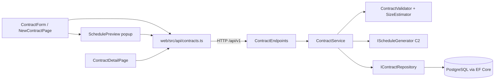
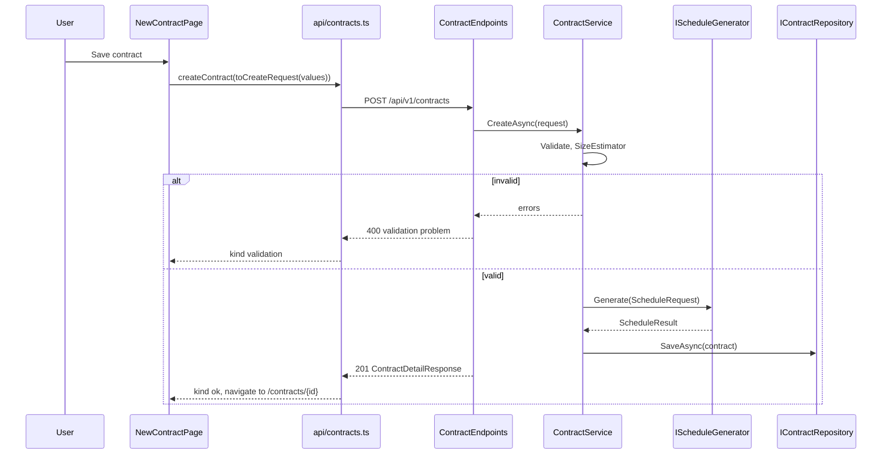
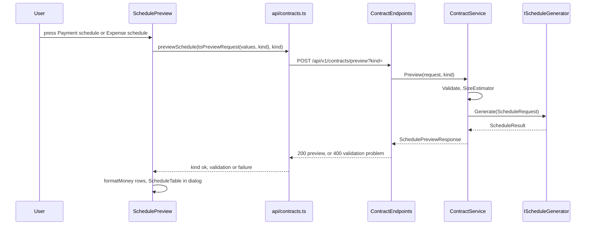
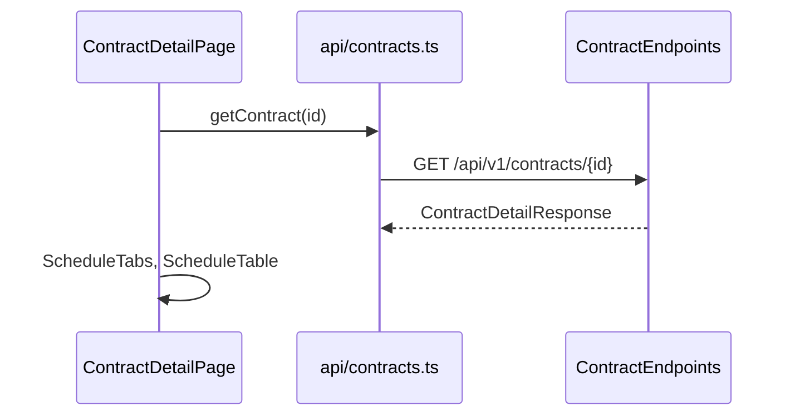

# Architecture

## Architecture Analysis

### System Overview
Three layers in one repository: a pure .NET schedule library, an ASP.NET Core API that validates, generates and persists, and a React single-page app that calls the API. Component list: `component-inventory.md`.

### Architectural Style
Layered monolith API plus a separate SPA. The API is endpoint, service, repository (`ContractEndpoints` to `ContractService` to `IContractRepository`). The schedule engine is a stateless library behind `IScheduleGenerator` (contract C2) with no I/O (enforced by a banned-API analyzer). The web app only calls the API (contract C1) and never calculates schedules or money (`display.ts` header: formatters never add, split or round money; `ScheduleTable`: totals come from the API).

### Component Relationships

Text fallback: the web client calls the endpoints (the form also calls the preview endpoint through the popup); endpoints call the service; the service validates, calls the schedule generator, then (create only) the repository, which writes to PostgreSQL.

### Data Flow
Create: form values, then `toCreateRequest`, then JSON POST, then validation (all errors reported together as a validation problem), then size estimate, then `Generate`, then totals check, then save in one transaction, then 201 with `ContractDetailResponse`. Preview: form values, then `toPreviewRequest`, then `POST /contracts/preview?kind=payment|expense`, then the same validation, size estimate and `Generate`, then `SchedulePreviewResponse` (nothing saved). Read: repository loads contract with streams and both entry lists, `ContractMapper.ToDetail` shapes the response; totals are summed from rows by the mapper (or by `Preview`).

### Expense schedule display and data path (relevant to the active intent)
- Engine: `ScheduleGenerator.Generate` runs `PaymentScheduleBuilder.Build` (payments ordered by due date, then stream position; total) then `ExpenseScheduleBuilder.Build(expense, paymentTotal)`. Expense rows are `ExpenseEntry(PeriodStart, PeriodEnd, Amount)`: Overtime is one row per calendar month, `round(base * monthDays / totalDays, 2)` away from zero, the last row takes `base - allocated`; AllAtOnce is one row with start = end; None is empty.
- Mapping: `ContractService.CreateAsync` copies rows into `PaymentScheduleEntry` and `ExpenseScheduleEntry` (Domain/, outside this scan); tables `payment_schedule_entries` and `expense_schedule_entries` (numeric(18,2) amounts, indexed by contract and date). Response records: `PaymentEntryResponse`, `ExpenseEntryResponse`, `ExpenseScheduleResponse(Entries, Total)` in `Responses.cs`; preview: `PreviewPaymentEntryResponse`, `SchedulePreviewResponse` in `Preview.cs`. Only InitialCreate exists as migration.
- Frontend: `ScheduleTabs.tsx` (saved) and `SchedulePreview.tsx` `PreviewBody` (preview) each turn entries into `ScheduleRow` (`Record<string, string>`) with `formatMoney` (`amount.toFixed(2)`), `formatDate` (YYYY-MM-DD), `formatMonth` (YYYY-MM), and pick column sets (Overtime: Month, Amount; AllAtOnce: Date, Amount; payment: Due date, Stream, Amount). `ScheduleTable.tsx` renders them, right-aligns only the last column by CSS, shows one Total cell in the foot (`colSpan = columns.length - 1`), pages at 100 rows.
- Payment/expense relation: none in code. A payment-versus-expense-by-period comparison would be new logic; `PaymentEntry.DueDate` and `ExpenseEntry.PeriodEnd` are the available join keys.

### Key Design Decisions
- Server is authoritative for validation; the client repeats the rules for fast feedback (`web/src/contracts/validation.ts`).
- Schedules are generated at save time and stored; reads never recompute them. Preview generates on demand and stores nothing.
- Stream ids are assigned by the service (`Guid.NewGuid()`), so schedule rows reference their stream by id; preview rows carry a 1-based `streamNumber` instead.
- API client never retries, sends no credentials, and accepts an `AbortSignal` (`web/src/api/contracts.ts`).
- CORS allows only GET and POST with the Content-Type header, for one configured origin.

### Improvement Opportunities
- Row mapping and column sets for expense and payment are duplicated in `ScheduleTabs.tsx` and `SchedulePreview.tsx`; a shared mapper would keep a new column change in one place.
- `ScheduleTable` assumes one right-aligned amount column and one total cell.

## Interaction Diagrams

### Create a contract

Text fallback: the page sends the request; the service validates, generates schedules, saves, and returns the detail, or a 400 with field errors; the page then navigates to the detail screen or shows the errors.

### Preview schedules (nothing saved)

Text fallback: pressing a preview button posts the form values; the service validates and generates both schedules without saving; the popup formats the rows and shows them in a table, or shows the errors with a retry.

### View a saved contract

Text fallback: the detail page fetches the contract and renders both schedules with `ScheduleTabs` and `ScheduleTable`.
