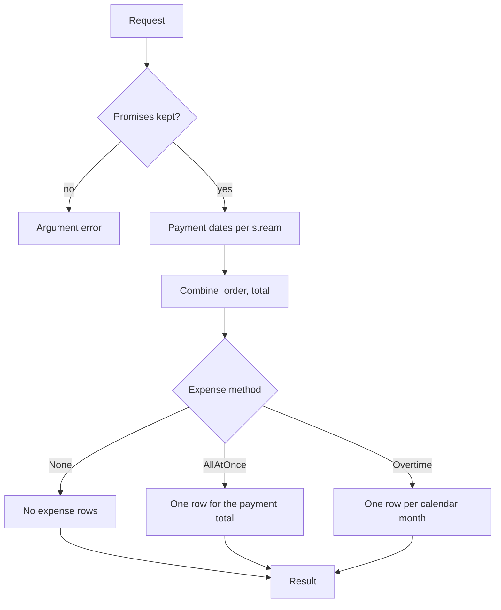

# Functional Specification: u1-schedule-engine

Implements stories US4.1 (generate the payment schedule) and US5.1 (generate the expense schedule). The engine is the library behind contract C2: one call, `Generate(ScheduleRequest)`, returns a `ScheduleResult`.

## Workflow: Generate schedules

1. Check the request against the promises in BR1.8. If one is broken, stop with an argument error.
2. For each stream in the order given, produce its payment dates (BR1.1 to BR1.5) and one `PaymentEntry` per date.
3. Combine the entries of all streams and order them (BR1.6). Add up `paymentTotal`.
4. Look at the expense method:
   - None: expenses are empty and `expenseTotal` is 0 (BR2.5).
   - AllAtOnce: one row on the expense date for `paymentTotal` (BR2.1, BR2.2).
   - Overtime: build the monthly rows (BR2.3) and fill in the amounts (BR2.4, BR2.6).
5. Add up `expenseTotal` and return the result.

Text fallback: validate; make payment dates per stream; combine, order and total them; then pick the expense method (None gives no rows, AllAtOnce gives one row, Overtime gives one row per calendar month); return the result.

## Workflow: Payment dates for one stream

1. If the frequency is OneTime, produce one payment on the start date and stop (BR1.5).
2. Otherwise set n to 0.
3. Work out the date for payment n: for Weekly, start date plus 7 times n days (BR1.2); for the month-based frequencies, start date plus n steps of 1, 3 or 12 months, with the day cut back to the last day of a short month (BR1.3).
4. If that date is after the stream's end date, stop (BR1.4). Otherwise record the payment and add 1 to n, then go back to step 3.

## Worked Examples

These examples are the checks the tests use.

**Month-end payments (AC4.1.2).** Monthly, start 2027-01-31, end 2027-04-30, amount 1000:
2027-01-31, 2027-02-28, 2027-03-31, 2027-04-30. Four payments, total 4000.

**Plain monthly (AC4.1.1).** Monthly, 2027-01-15 to 2027-04-15, amount 1000: 2027-01-15, 02-15, 03-15 and 04-15.

**Weekly (AC4.1.4).** Weekly, start 2027-12-20, end 2028-01-10, amount 100: 2027-12-20, 12-27, 2028-01-03, 01-10. The year changes without a gap.

**One-time (AC4.1.3).** OneTime, 500 on 2027-06-01: one payment, 2027-06-01, 500.

**Overtime with rounding (AC5.1.2, AC5.1.3).** Payment total 3100, Overtime 2027-01-01 to 2027-03-31 (90 days):

| Row | Days | Amount | How |
|---|---|---|---|
| January | 31 | 1067.78 | 3100 x 31 / 90 = 1067.777..., rounded |
| February | 28 | 964.44 | 3100 x 28 / 90 = 964.444..., rounded |
| March (last) | 31 | 1067.78 | 3100 minus 1067.78 minus 964.44 |

The three rows add up to exactly 3100.00.

**Overtime starting mid-month (AC5.1.4).** Payment total 900, Overtime 2027-01-20 to 2027-02-28 (40 days): January covers 12 days, 900 x 12 / 40 = 270.00; February covers 28 days and is the last row, 900 minus 270.00 = 630.00.

**All at once (AC5.1.1).** Payment total 12000, date 2027-03-01: one row, 2027-03-01 to 2027-03-01, 12000.

## Edge Cases

- A stream whose start date is also its end date, with a repeating frequency, has one payment (BR1.4).
- An Overtime range inside one calendar month has one row holding the whole amount (BR2.4).
- An Overtime range of a single day has one row for that day.
- Annually from 29 February: the payment falls on 28 February in non-leap years and on 29 February in leap years (BR1.3).
- Two streams paying on the same date: both entries appear, ordered by stream position (BR1.6).
- Expense method None with several streams: payments are generated and totalled; the expense side is empty.

## State Transitions

None. The engine keeps no state.

## Stories Implemented

- US4.1: BR1.1 to BR1.7.
- US5.1: BR2.1 to BR2.6.
