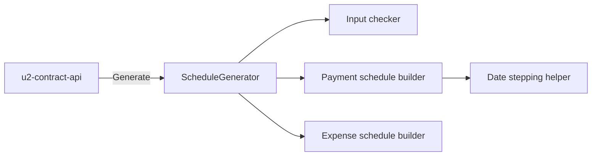

# Logical Components: u1-schedule-engine

A library has no servers or failure domains of its own. It runs inside the backend's process (U2), so its failures and limits are the backend's.

## Inventory

| Logical component | Role | Notes |
|---|---|---|
| ScheduleGenerator (class) | The public entry point. Implements `IScheduleGenerator.Generate`. Checks input, then calls the two builders below. | Stateless: safe to share one instance across threads. |
| Input checker | Applies BR1.8 and the 100,000-entry limit (NFR6.1, NFR6.2). | Internal. Runs first. |
| Payment schedule builder | Applies BR1.1 to BR1.7: dates per stream, combine, order, total. | Internal. Pure function of the streams. |
| Expense schedule builder | Applies BR2.1 to BR2.6 from the payment total and the expense input. | Internal. Pure function of the total and the expense input. |
| Date stepping helper | Adds weeks or months to a start date with the end-of-month rule (BR1.3). | Internal. Always counts from the original start date. |

Text fallback: the backend (U2) calls ScheduleGenerator. ScheduleGenerator uses the input checker, the payment schedule builder and the expense schedule builder. The payment schedule builder uses the date stepping helper.

## Failure Domains and Blast Radius

- **Failure domain:** the same process as U2. There is no network between them, so there is no partial failure: a call returns or throws.
- **Blast radius of a defect:** a wrong date or amount would be saved by U2 into every new contract. That is why the rules carry the most test weight (Bolt 1 risk-first order).
- **Shared resources:** none. No database, cache, file or lock.

## Where NFR Patterns Apply

| NFR | Where it is applied |
|---|---|
| NFR3.1, NFR3.2 | ScheduleGenerator public interface and the build check on banned APIs |
| NFR4.1, NFR4.2, NFR4.3 | Both builders (decimal money, rounding) and the immutable records |
| NFR5.1 | Payment schedule builder and Expense schedule builder (linear in the number of entries) |
| NFR6.1, NFR6.2 | Input checker |
| NFR7.1, NFR7.2 | Project layout: the library and its xUnit tests in separate projects with no web or database reference |
