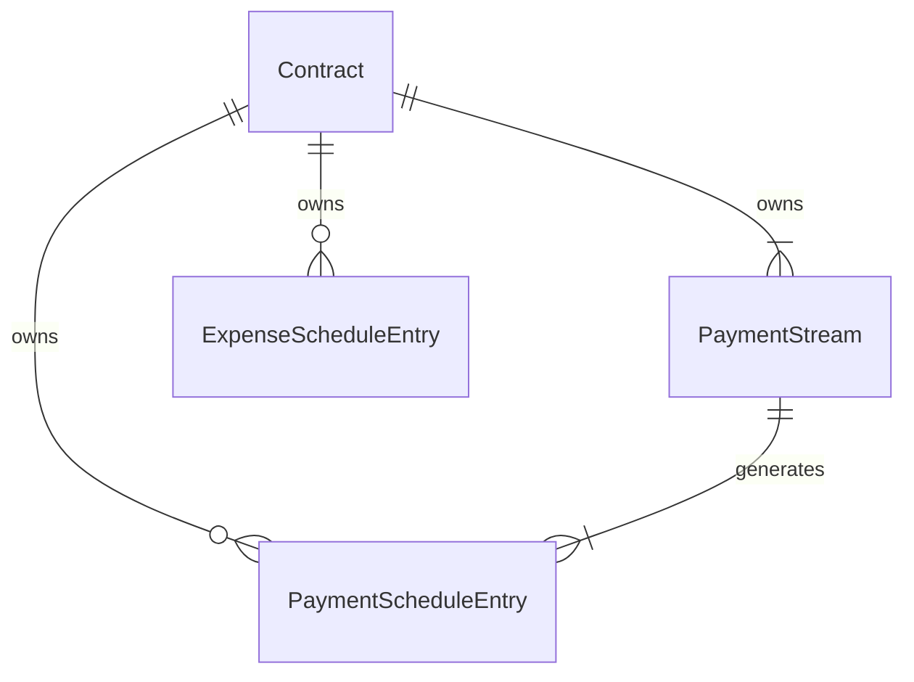

# Functional Specification: u2-contract-api

Stories this Unit implements: US1.1, US2.1, US3.1, US4.1, US5.1, US6.1, US6.2, US6.3 (the acceptance criteria are listed in `traceability.json`). Contracts: C1 (served by this Unit), C2 (consumed from u1-schedule-engine). This file is the source of truth for the workflows and state transitions. `entities.md` and `rules.md` hold the data shape and the rules.

## Workflow 1. Create a contract (POST /api/v1/contracts)

1. Read the JSON body. IF it is not valid JSON or has the wrong types THEN return 400 with the field paths it can name.
2. Validate the contract: BR1.1, BR1.2.
3. Validate the streams: BR2.1, then for each stream BR2.2, BR2.3, BR2.4, BR2.6; apply BR2.5.
4. Validate the expense: BR3.1, then the rules for the chosen method BR3.2, BR3.3, BR3.4; apply BR3.5.
5. IF any message was collected in steps 2 to 4 THEN return 400 ValidationProblem with every message. Nothing is saved.
6. Check the size cap BR5.4. IF it fails THEN return 400 as above.
7. Map the validated contract to a C2 `ScheduleRequest` (stream ids are generated here, in request order) and call `Generate` (BR4.1).
8. Check the totals agree (BR4.2).
9. Open one transaction. Save the contract, its streams, the payment rows and the expense rows (BR5.1). Commit.
10. Return 201 with the saved contract (the C1 ContractDetail) and a `Location` header `/api/v1/contracts/{id}`.
11. IF step 7, 8 or 9 fails THEN roll back, log the details, and return 500 Problem Details (BR6.3).

## Workflow 2. Read one contract (GET /api/v1/contracts/{id})

1. IF `id` is not a valid identifier THEN return 404 (BR5.2).
2. Load the contract with its streams and both schedules in one read. IF it does not exist THEN return 404.
3. Compute both totals from the rows (BR4.2) and return 200 ContractDetail. For method None the expense schedule is empty and its total is 0.

## Workflow 3. List contracts (GET /api/v1/contracts)

1. Read `page` and `pageSize`. IF either is invalid THEN return 400 (BR5.3).
2. Count all contracts. Read the requested page ordered by startDate descending, name ascending, contractId.
3. Return 200 ContractPage with `items` (id, name, startDate, endDate), `page`, `pageSize`, `totalCount`, `totalPages`.

## State and lifecycle

A contract has no states. It is created once, in one step, and never changes, because editing and deleting are out of scope. The only transition is *not saved* to *saved*, and it happens only when the transaction commits.

```
(request) --validation passes, generation passes, commit--> [Saved]
(request) --any failure--> (nothing stored)
```

## Entity-relationship view (derived from entities.md)



Text fallback: a Contract owns one or more PaymentStreams, zero or more PaymentScheduleEntry rows and zero or more ExpenseScheduleEntry rows. Each PaymentStream generates one or more PaymentScheduleEntry rows.

## Rules summary (derived from rules.md)

Validation: BR1.1, BR1.2, BR2.1 to BR2.4, BR2.6, BR3.1 to BR3.4. Calculation and mapping: BR2.5, BR3.5, BR4.1, BR4.2. Save and read: BR5.1 to BR5.4. Platform: BR6.1 to BR6.3. Policy from your answers: duplicate names allowed (BR1.3), no stream cap and a 10,000 row cap (BR5.4), local database `contract_management` with the password from configuration (BR6.2).

## Error handling and edge cases

- Several mistakes in one request: all messages return together, grouped by field path.
- Contract dates invalid: stream and expense date-range checks are skipped so one mistake does not cause a pile of messages.
- Whitespace around the name is trimmed before it is stored. Dates are calendar dates with no time zone.
- Two saves of the same input at the same time give two contracts (duplicates are allowed). Each save is its own transaction.
- A database that is down at request time gives 500 and nothing is stored; the connection details never appear in the response or the log.
- Leap days: Feb 29 and Overtime day counts are handled by the schedule engine (u1), not here.

## Integration points

- **u1-schedule-engine (C2):** one in-process `Generate` call per save, after validation. U2 meets every U1 precondition, so an `ArgumentException` from U1 is a defect and returns 500.
- **u3-contract-web (C1):** the C1 paths, shapes and ordering are unchanged. This design adds message wording for cases the Refined Mockups spec did not cover: `Enter a valid date.`, `Choose a frequency.`, `Choose an expense method.`, `Add at least one payment stream.`, `Amount can have at most 2 decimal places.`, `Contract name must be 200 characters or fewer.`, the 10,000 row message, and the paging messages. These only add messages, so v1 stays compatible; u3 should use the same wording when it builds its checks.
- **PostgreSQL:** reached only through ContractRepository (BR6.2).

## Business scenarios

- Happy path: Monthly stream 1000 over four months plus All at once expense: 201, four payment rows, one expense row of 4000.
- Invalid: blank name and amount 0: 400 with `name` and `paymentStreams[0].amount` messages, nothing saved.
- Storage failure during save: 500, no contract without its schedules.
- Unknown id: 404 'Contract not found.'
- Empty database list: 200 with empty `items`, `totalCount` 0, `totalPages` 0.
