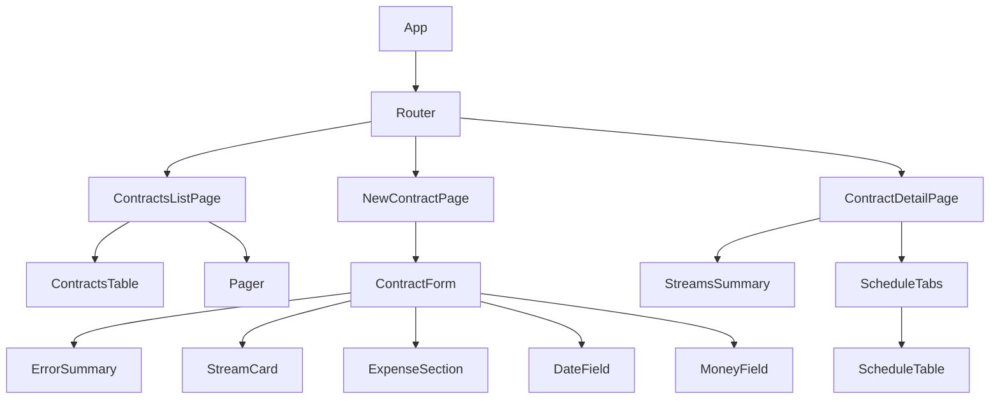

# Frontend Components: u3-contract-web

Built with React and shadcn/ui, as mapped in `design-system-mapping.md`. Every interactive element carries a `data-testid` for tests.

## Component Hierarchy

Text fallback: App holds the Router, which shows ContractsListPage (ContractsTable, Pager), NewContractPage (ContractForm with ErrorSummary, StreamCards, ExpenseSection, DateField and MoneyField) or ContractDetailPage (StreamsSummary, ScheduleTabs with ScheduleTables).

## Components

| Component | Purpose | Props | Local state | data-testid |
|---|---|---|---|---|
| App | Providers and the router | none | none | `app` |
| ContractsListPage | S1: reads page and size from the address, loads the page | none | loading state, page data, error | `contracts-list-page` |
| ContractsTable | Rows of name, start and end dates | `items` | none | `contracts-table`, `contract-row-{id}` |
| Pager | Previous, Next, page-size select | `page`, `pageSize`, `totalCount`, `totalPages`, `onPageChange`, `onPageSizeChange` | none | `pager`, `pager-prev`, `pager-next`, `page-size-select` |
| NewContractPage | S2: hosts the form, sends the request, handles the outcome | none | save status (idle, saving, failed), API field errors | `new-contract-page` |
| ContractForm | The whole entry form | `status`, `apiErrors`, `onSubmit`, `onCancel` | form values (React Hook Form), discard dialog open | `contract-form`, `save-contract`, `cancel-contract` |
| ErrorSummary | Lists all errors, each linking to its field; receives focus after a failed save | `errors` | none | `error-summary` |
| DateField | A date input with a calendar picker and typed entry | `name`, `label`, `error` | popover open | `{name}-input` |
| MoneyField | Amount input that formats to 2 decimals on blur | `name`, `label`, `error` | none | `{name}-input` |
| StreamCard | One payment stream's fields in a `fieldset` with a legend "Payment stream N" | `index`, `canRemove`, `onRemove` | none (values live in the form) | `stream-card-{index}`, `remove-stream-{index}` |
| ExpenseSection | Method radio group and the date fields for the chosen method | none | none | `expense-method`, `expense-method-{value}` |
| ContractDetailPage | S3: loads one contract and shows it | none | loading state, contract, error, not-found, banner dismissed | `contract-detail-page` |
| StreamsSummary | Frequency, amount and dates of each stream | `streams` | none | `streams-summary` |
| ScheduleTabs | Payment and Expense tabs | `paymentSchedule`, `expenseSchedule`, `expenseMethod` | selected tab | `schedule-tabs`, `tab-payment`, `tab-expense` |
| ScheduleTable | A schedule as a table with a caption and a total row | `columns`, `rows`, `total`, `emptyMessage` | none | `schedule-table-{name}` |

## Data and API Layer

A small module, `api/contracts.ts`, holds the three calls and the types that mirror contract C1:

| Function | Request | Result |
|---|---|---|
| `createContract(input)` | `POST /api/v1/contracts` | `ContractDetail`, or a typed error: `validation` with the `errors` map, or `failure` |
| `listContracts(page, pageSize)` | `GET /api/v1/contracts` | `ContractPage` |
| `getContract(id)` | `GET /api/v1/contracts/{id}` | `ContractDetail`, or `notFound` |

Components never call `fetch` directly. Tests replace this module with a fake that follows contract C1.

## Form Validation

The validation rules live in one schema (Zod, through React Hook Form's resolver) that implements the table in `functional-spec.md`. Messages are constants shared by the schema and the API-error mapper.

## Interaction Flows

- **Add stream:** appends an empty StreamCard and moves focus to its Amount field.
- **Remove stream:** removes the card and moves focus to the Add stream button.
- **Change frequency to OneTime:** hides the stream end date, shows "Payment date", clears the end date.
- **Change expense method:** shows the fields for that method and clears the others.
- **Save:** as workflow W1.
- **Tabs:** arrow keys move between tabs (Radix Tabs).

## Accessibility Hooks

- Each field has a visible label. Errors are tied to fields with `aria-describedby` and invalid fields set `aria-invalid`.
- The error summary and failure alerts use `role="alert"`; the "Contract saved." banner uses `role="status"`.
- Schedule tables use `caption`, `th scope="col"` and a `tfoot` total row. On narrow screens the table sits in a scrollable region that is keyboard focusable.
- Targets are at least 24 by 24 CSS pixels, and focus is never hidden behind a sticky element (the WCAG 2.2 AA checklist).
