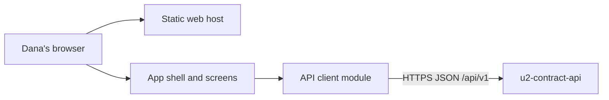

# Logical Components: u3-contract-web

The frontend is a set of static files served from its own address. It runs in Dana's browser and talks to u2-contract-api over HTTP.

## Inventory

| Logical component | Role | Notes |
|---|---|---|
| Static web host | Serves the built files from `web/dist` | Any static host. No server code. Settled in this unit's Infrastructure Design. |
| App shell and router | Loads the screens and keeps page and page size in the address | Screens load on demand (NFR5.5). |
| Screens S1, S2, S3 | Contracts list, New contract, Contract detail | See frontend-components.md. |
| API client module | The only code that calls the backend | Sends no credentials. Base address from configuration (NFR3.7). |
| Validation schema | One schema for the form rules and messages | Mirrors the backend; the backend's answer wins (NFR6.3). |

Text fallback: the browser loads the app from the static host; the screens call the API client module, which is the only part that talks to u2-contract-api over HTTPS.

## Failure Domains and Blast Radius

- **Static host down:** the app does not load. No data is lost; the backend is untouched.
- **Backend down or slow:** every screen shows its error state with Retry, and the New contract form keeps Dana's entries. Nothing is half-saved, because the backend saves all or nothing (FR6.1).
- **A frontend defect:** affects display only. It cannot change stored contracts or totals, because the client never calculates money (NFR4.4).
- **Shared resources:** none on the client side. The backend address is the only shared dependency.

## Where NFR Patterns Apply

| NFR | Where |
|---|---|
| NFR5.2 | NewContractPage save status |
| NFR5.3 | ScheduleTable |
| NFR5.4 | API client module and screen loading |
| NFR5.5 | App shell and router (code splitting), build output check |
| NFR3.4, NFR3.7 | API client module |
| NFR3.5 | Every component that shows API text |
| NFR3.6 | App-wide (no storage APIs) |
| NFR3.8 | Build and dependency check |
| NFR6.3, NFR6.4 | Validation schema and ContractForm |
