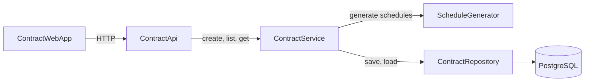

# Component Catalogue

Logical building blocks of the contract management system. A component is code we write. PostgreSQL is a dependency, not a component. Deployment grouping is decided in Units Generation.

## Machine-readable catalogue

```yaml
components:
  - name: ContractWebApp
    summary: React single-page app where Dana enters contracts and reads schedules.
    behaviour: >
      Shows the contracts list, the one-page New contract form and the contract detail view with
      payment and expense schedule tabs. Checks fields as the user types and shows the same messages
      the backend returns. Never generates schedules itself; it only displays what the API returns.
    responsibilities:
      - Render the contracts list, contract entry form and contract detail screens
      - Client-side field validation and error summary
      - Call the contract API and show loading, empty and error states
    depends_on:
      - component: ContractApi
        interaction: create, list and read contracts over HTTP
        style: sync
    dependents: []
    external_dependencies:
      - name: shadcn/ui
        kind: other
        purpose: UI component library
    entities: []

  - name: ContractApi
    summary: .NET HTTP endpoints that expose contract creation, listing and reading.
    behaviour: >
      Accepts a contract entry request, rejects malformed input with a validation error response
      using the agreed message wording, and passes valid requests to ContractService. Maps a missing
      contract to a not-found response. Holds no business rules beyond request shape.
    responsibilities:
      - Define the request and response shapes for contracts and schedules
      - Translate service outcomes (saved, invalid, not found, failure) into HTTP responses
    depends_on:
      - component: ContractService
        interaction: create, list and fetch contracts
        style: sync
    dependents:
      - component: ContractWebApp
        interaction: receives contract requests from the UI
    external_dependencies: []
    entities: []

  - name: ContractService
    summary: Applies the contract rules, asks for schedules, and saves the contract with them.
    behaviour: >
      Validates the contract (name, dates, stream rules, expense rules, all within contract dates),
      asks ScheduleGenerator for the payment and expense schedules, then saves the contract, its streams
      and both schedules in one transaction through ContractRepository. If any step fails, nothing is stored.
      Owns the Contract aggregate.
    responsibilities:
      - Contract validation rules (FR1, FR2, FR3 date and amount rules)
      - Orchestrate generate then save as one operation (FR6.1)
      - Own the Contract, PaymentStream, PaymentScheduleEntry and ExpenseScheduleEntry entities
    depends_on:
      - component: ScheduleGenerator
        interaction: generate payment and expense schedules from a validated contract
        style: sync
      - component: ContractRepository
        interaction: store and load a contract with its schedules
        style: sync
    dependents:
      - component: ContractApi
        interaction: handles contract requests
    external_dependencies: []
    entities:
      - name: Contract
        identifier: contractId
        attributes: [name, startDate, endDate, expenseMethod, expenseStartDate, expenseEndDate, expenseDate]
        references: []
      - name: PaymentStream
        identifier: streamId
        attributes: [contractId, amount, frequency, startDate, endDate]
        references: []
      - name: PaymentScheduleEntry
        identifier: paymentEntryId
        attributes: [contractId, streamId, dueDate, amount]
        references: []
      - name: ExpenseScheduleEntry
        identifier: expenseEntryId
        attributes: [contractId, periodOrDate, amount]
        references: []

  - name: ScheduleGenerator
    summary: Pure rules that turn payment streams and an expense method into schedules.
    behaviour: >
      Given validated streams and an expense method, returns the payment schedule (dates by frequency,
      last-day-of-month rule, one-time payments) and the expense schedule (All at once, Overtime split
      equally per day and summed per calendar month, rounding difference on the last row, None is empty).
      Deterministic. No database, clock or network access, so it can be tested on its own (NFR7).
    responsibilities:
      - Payment date generation for Weekly, Monthly, Quarterly, Annually and One-time streams (FR4)
      - Expense schedule generation for the three methods (FR5)
      - Rounding to 2 decimals so totals match exactly (FR5.5, NFR4)
    depends_on: []
    dependents:
      - component: ContractService
        interaction: asks for schedules
    external_dependencies: []
    entities: []

  - name: ContractRepository
    summary: Stores and loads contracts with their schedules in PostgreSQL.
    behaviour: >
      Saves a whole Contract aggregate (contract, streams, payment rows, expense rows) in one database
      transaction and rolls back on any failure. Loads a contract with all its parts, and lists contracts
      with name and dates.
    responsibilities:
      - Persist and load the Contract aggregate atomically (FR6.1)
      - List contracts for the list screen (FR6.3)
    depends_on: []
    dependents:
      - component: ContractService
        interaction: stores and loads contracts
    external_dependencies:
      - name: PostgreSQL
        kind: database
        purpose: stores contracts, streams and both schedules
    entities: []
```

## Component Diagram



Text fallback: ContractWebApp calls ContractApi. ContractApi calls ContractService. ContractService calls ScheduleGenerator (to generate schedules) and ContractRepository (to save and load). ContractRepository uses PostgreSQL.

## Component Summary

| Component | Purpose | Depends On | Dependents | Entities Owned |
|---|---|---|---|---|
| ContractWebApp | React screens for entry and viewing | ContractApi | none | none |
| ContractApi | HTTP endpoints and request or response shapes | ContractService | ContractWebApp | none |
| ContractService | Contract rules, orchestration, save as one unit | ScheduleGenerator, ContractRepository | ContractApi | Contract, PaymentStream, PaymentScheduleEntry, ExpenseScheduleEntry |
| ScheduleGenerator | Pure payment and expense schedule rules | none | ContractService | none |
| ContractRepository | PostgreSQL persistence of the Contract aggregate | none | ContractService | none |

## Entity Ownership

| Entity | Owning Component | Identifier | Attributes | References |
|---|---|---|---|---|
| Contract | ContractService | contractId | name, startDate, endDate, expenseMethod, expenseStartDate, expenseEndDate, expenseDate | none |
| PaymentStream | ContractService | streamId | contractId, amount, frequency, startDate, endDate | none |
| PaymentScheduleEntry | ContractService | paymentEntryId | contractId, streamId, dueDate, amount | none |
| ExpenseScheduleEntry | ContractService | expenseEntryId | contractId, periodOrDate, amount | none |

All four entities form one Contract aggregate owned by ContractService (answer to Q2). References between them are inside the aggregate.

## External Dependencies

| Component | Dependency | Kind | Purpose |
|---|---|---|---|
| ContractWebApp | shadcn/ui | other | UI components |
| ContractRepository | PostgreSQL | database | contracts, streams and schedules |

## Rationale

| Component | Why it is a separate building block |
|---|---|
| ContractWebApp | Distinct runtime (browser) and change rate (screens change often). |
| ContractApi | Distinct concern: the HTTP contract and error mapping. Changes when clients change, not when rules change. |
| ContractService | Owns the contract rules and the single save operation. Distinct data ownership: the Contract aggregate. |
| ScheduleGenerator | Distinct concern and change rate (date and rounding rules), no data store. Separate by choice in Q1 so it can be tested alone (NFR7). |
| ContractRepository | Distinct concern: storage. Isolates PostgreSQL so rules never depend on it. |

**Alternatives Rejected:**
- Generation inside ContractService (Q1, option B): fewer blocks, but testing the rules would need the service or a fake store. See ADR-001.
- A separate Schedule component with its own storage (Q2, option B): useful only if schedules were edited later, which is out of scope. See ADR-002.
