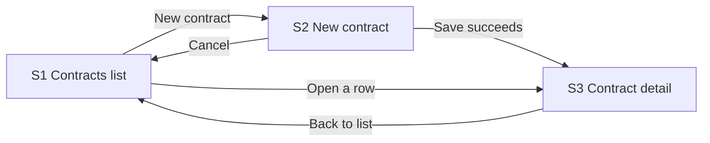

# Mockups

Screens for the contract management system, designed from the user stories (US1.1 to US6.3) and requirements. The entry form is one page with three sections (Q1). Components come from shadcn/ui (Q2). Text wireframes are used because they stay readable in version control.

## Screen Map

| Screen | Route | Stories |
|---|---|---|
| S1 Contracts list | `/contracts` | US6.3 |
| S2 New contract | `/contracts/new` | US1.1, US2.1, US3.1, US6.1 |
| S3 Contract detail | `/contracts/:id` | US6.1 (after save), US6.2, US4.1, US5.1 |



Text fallback: S1 goes to S2 (New contract) or S3 (open a row). S2 goes to S3 on a successful save, or back to S1 on Cancel. S3 goes back to S1.

## S1. Contracts list (US6.3)

```
+--------------------------------------------------------------+
| Contracts                                  [ + New contract ]|
+--------------------------------------------------------------+
| Name                     | Start        | End                |
|--------------------------+--------------+--------------------|
| Office lease HQ          | 2027-01-01   | 2029-12-31         |
| Cloud hosting agreement  | 2027-03-15   | 2028-03-14         |
| Software licence         | 2027-06-01   | 2027-06-01         |
+--------------------------------------------------------------+
```

States:
- **Loading:** table skeleton rows.
- **Empty (AC6.3.2):** "No contracts yet." with the New contract button below it.
- **Error:** inline alert "Could not load contracts." with a Retry button.

## S2. New contract (US1.1, US2.1, US3.1, US6.1)

```
+--------------------------------------------------------------+
| New contract                                                 |
+--------------------------------------------------------------+
| 1  Details                                                   |
|   Contract name *  [______________________________]         |
|   Start date *     [ 2027-01-01 ]   End date * [ 2027-12-31 ]|
+--------------------------------------------------------------+
| 2  Payment streams                       [ + Add stream ]    |
|   Stream 1                                      [ Remove ]   |
|     Amount * [ 1000.00 ]  Frequency * [ Monthly       v ]    |
|     Stream start * [ 2027-01-15 ]  Stream end * [ 2027-12-15]|
|   Stream 2                                      [ Remove ]   |
|     Amount * [ 500.00 ]   Frequency * [ One-time      v ]    |
|     Payment date * [ 2027-06-01 ]                            |
+--------------------------------------------------------------+
| 3  Expense                                                   |
|   Expense method *  ( ) Overtime  (o) All at once  ( ) None  |
|   Expense date *    [ 2027-03-01 ]                           |
+--------------------------------------------------------------+
|                               [ Cancel ]   [ Save contract ] |
+--------------------------------------------------------------+
```

Variants of section 3:
- **Overtime:** two date fields, "Expense start date *" and "Expense end date *" (AC3.1.1).
- **All at once:** one field, "Expense date *" (AC3.1.2).
- **None:** no date fields, with the note "No expense schedule will be created." (AC3.1.3).

Variant of a stream:
- **One-time frequency:** only one date field, "Payment date *"; the end date is set equal to it (AC2.1.5).

States:
- **Initial:** contract name blank, one empty stream row, expense method None selected.
- **Validation error:** each invalid field shows its message under the field; an error summary at the top of the form lists them, each a link to its field (messages are the ones in AC1.1.2, AC1.1.3, AC2.1.3, AC2.1.4, AC3.1.4, AC3.1.5).
- **Saving:** the Save button shows a spinner and is disabled; the form fields are read-only.
- **Save failed (AC6.1.2):** an alert at the top, "The contract was not saved. Nothing was stored. Try again." The form keeps Dana's entries.
- **Success:** navigate to S3.

## S3. Contract detail (US6.1, US6.2, US4.1, US5.1)

```
+--------------------------------------------------------------+
| < Contracts     Office lease HQ                              |
+--------------------------------------------------------------+
| Period: 2027-01-01 to 2027-12-31                             |
| Expense method: All at once                                  |
+--------------------------------------------------------------+
| Payment streams                                              |
|  Monthly   1000.00   2027-01-15 to 2027-12-15                |
|  One-time   500.00   2027-06-01                              |
+--------------------------------------------------------------+
| [ Payment schedule ]  [ Expense schedule ]       (tabs)      |
|--------------------------------------------------------------|
| Due date     | Stream    | Amount                            |
| 2027-01-15   | Monthly   |   1000.00                         |
| 2027-02-15   | Monthly   |   1000.00                         |
| ...                                                          |
| 2027-06-01   | One-time  |    500.00                         |
|--------------------------------------------------------------|
|                                   Total          12500.00    |
+--------------------------------------------------------------+
```

Expense schedule tab:
- **Overtime:** columns Month and Amount, one row per month, with a Total row.
- **All at once:** one row with Date and Amount.
- **None (AC5.1.5):** the text "This contract has no expense schedule."

States:
- **Loading:** skeleton for the header and table.
- **Not found (AC6.2.2):** "Contract not found." with a link back to the list.
- **Error:** alert "Could not load this contract." with Retry.
- A just-saved contract shows a dismissible success banner, "Contract saved."

## Responsive Behavior

| Width | Behavior |
|---|---|
| 1024 px and wider | Layout as drawn. Stream fields sit on two rows inside each stream card. |
| 640 to 1023 px | Form sections stay full width. Stream fields wrap to two columns. |
| Under 640 px | One column everywhere. Schedule tables scroll horizontally inside their own region, and the table region is keyboard focusable. |
