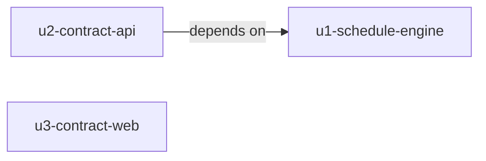

# Unit Dependencies

## Dependency DAG

- U2 (u2-contract-api) depends on U1 (u1-schedule-engine): the backend's code calls the schedule library, and its tests need it to pass.
- U1 depends on nothing.
- U3 (u3-contract-web) depends on nothing: its code and tests need only the HTTP contract from Contract Design, with a fake API in its tests.



Text fallback: u2-contract-api depends on u1-schedule-engine. u3-contract-web has no dependency on another unit.

```yaml
units:
  - name: u1-schedule-engine
    kind: library
    depends_on: []
  - name: u2-contract-api
    kind: service
    depends_on: [u1-schedule-engine]
  - name: u3-contract-web
    kind: ui
    depends_on: []
```

## Integration Points

| From | To | Mechanism | What crosses |
|---|---|---|---|
| U2 | U1 | In-process library call | Validated streams and expense method in; payment and expense schedules out |
| U3 | U2 | HTTP (JSON), cross-origin | Contract entry requests, contract list, contract detail with schedules, validation errors |
| U2 | PostgreSQL | Database connection | Contract aggregate rows |

## Parallel Development Opportunities

- U1 and U3 have no edge between them and can be built at the same time, each on its own.
- U2 can be built once U1 is available.
- Valid topological orderings include U1, U3, U2 and U3, U1, U2 and U1, U2, U3. Delivery Planning chooses among them.
