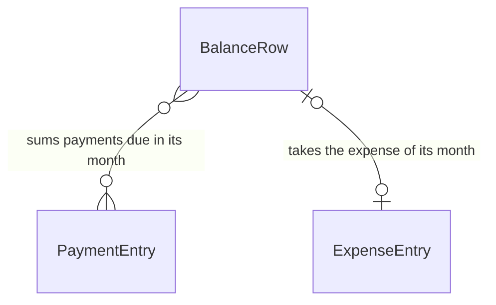

# Functional Specification: u1-schedule-balance

Stories this Unit implements (see `inception/user-stories/stories.md`): US1.1, US2.1, US2.2. Unit definition: U1 in `inception/units-generation/unit-of-work.md`; component: ScheduleGenerator in `inception/domain-design/components.md`. Contract: C2 (`inception/contract-design/contract-summary.md`). This file is the source of truth for the workflow; `entities.md` and `rules.md` hold the data shape and the rules.

## Workflow 1. Build balance rows

Input: the payment rows (due date, amount) and the expense rows (period start, period end, amount) of one contract.

1. IF the expense rows are empty THEN return no rows (BR1.1; method None, or a payment-only preview).
2. Check that the payment total equals the expense total; otherwise throw (BR3.2).
3. Collect the months of all payment due dates and all expense period starts; sort them (BR1.1).
4. For each month in order:
   1. Period: the Overtime expense row's period when the month has one, else the whole month (BR1.2).
   2. Expense: the month's expense, or 0 (BR1.3).
   3. (Accrual)/Prepaid: payments due in the month minus expense (BR2.1).
   4. Cumulative Balance: previous balance plus (Accrual)/Prepaid (BR2.2).
5. For each row, find the look-ahead balance (BR2.3), split the balance into ST and LT (BR2.4) and fill the columns by sign (BR2.5).
6. Return the rows.

## Workflow 2. Generate schedules

`Generate` keeps its payment and expense rules unchanged, then calls Workflow 1 on the rows it produced and returns them in `ScheduleResult.Balance` (BR3.1).

## State

None: the builder is a pure function of its input.

## Worked examples (used as the unit tests)

**E1. Prepaid, ends within 12 months** (AC2.1.1). 12,000.00 paid on 2027-01-15; Overtime 1,000.00 a month, 2027-01-01 to 2027-12-31.

| Month | Expense | (Accrual)/Prepaid | Balance | ST Prepaid | LT Prepaid |
|---|---|---|---|---|---|
| Jan 2027 | 1,000.00 | 11,000.00 | 11,000.00 | 11,000.00 | 0.00 |
| Feb 2027 | 1,000.00 | (1,000.00) | 10,000.00 | 10,000.00 | 0.00 |
| Dec 2027 | 1,000.00 | (1,000.00) | 0.00 | 0.00 | 0.00 |

The schedule ends before January 2028, so every balance is short term.

**E2. Prepaid with an LT part** (AC2.2.1). 24,000.00 paid on 2027-01-15; Overtime 500.00 a month, 2027-01-01 to 2030-12-31. End of January 2027 balance 23,500.00; end of January 2028 balance 17,500.00. ST Prepaid 6,000.00, LT Prepaid 17,500.00.

**E3. Accrual** (AC2.1.2). All at once 9,000.00 on 2027-01-31; Monthly 1,000.00 from 2027-04-01 to 2027-12-01. January row: expense 9,000.00, (Accrual)/Prepaid (9,000.00), balance (9,000.00), ST Accrued 9,000.00. February and March have no row. April row: expense 0.00, 1,000.00, balance (8,000.00). December row: balance 0.00.

**E4. Partial accrual reversal** (Units Generation and Requirements review findings). Balance (9,000.00) at a month end and (3,000.00) twelve months later: ST Accrued 6,000.00, LT Accrued 3,000.00.

**E5. Sign change** (AC2.2.3). Balance 2,000.00 now and (1,000.00) twelve months later: ST Prepaid 2,000.00, LT 0.00.

**E6. Larger same-sign later balance.** Balance 2,000.00 now and 5,000.00 twelve months later: ST Prepaid 0.00, LT Prepaid 2,000.00.

**E7. Look-ahead to a month with no row.** A row in March 2027; the latest row on or before March 2028 is January 2028, so January 2028's balance is used.

**E8. Leap year.** A row in February 2027 looks at the February 2028 row (period end 29 February 2028).

**E9. Payment-only month before an Overtime range** (AC1.1.1). One-time 3,000.00 on 2027-01-15; Overtime from 2027-03-01 to 2027-05-31. Rows: January (expense 0.00, whole month), March, April, May. No February row.

**E10. Method None** (AC1.1.4). No expense rows: no balance rows.

## Error handling

- Mismatched totals: argument error (BR3.2). U2 never sends such input, because both lists come from the same generation.
- No other failures: the builder does no I/O.

## Integration points

- U2 calls the builder with stored rows when reading a saved contract, and reads `ScheduleResult.Balance` for previews (contract C2).

## Entity relationships (derived from entities.md)

Text fallback: each balance row sums the payments due in its month and takes the expense row of its month, if any.

## Rules summary (derived from rules.md)

BR1.1 to BR1.3 build the monthly rows; BR2.1 to BR2.5 calculate the columns; BR3.1 keeps preview and saved contract the same; BR3.2 checks the totals.
