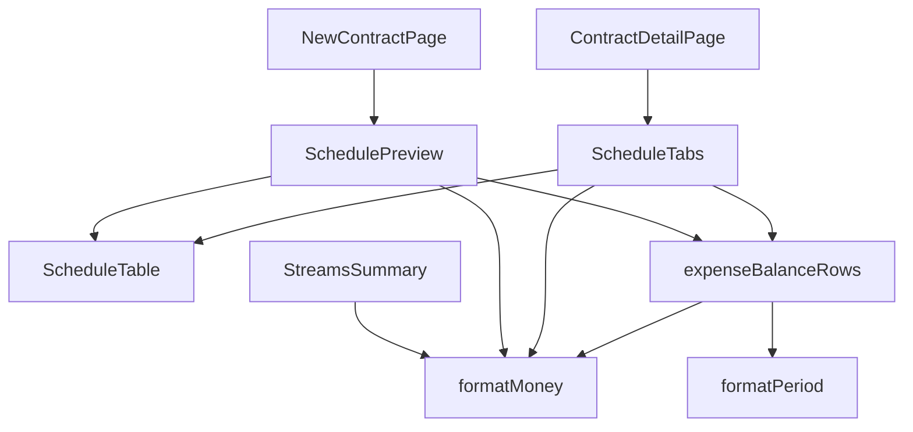

# Frontend Components: u3-web-balance

Implements the workflows in `functional-spec.md` (same folder). Sources: U3 in `aidlc/spaces/default/intents/261118-expense-balance-columns/inception/units-generation/unit-of-work.md`, its rows in `aidlc/spaces/default/intents/261118-expense-balance-columns/inception/units-generation/unit-of-work-story-map.md`, the stories in `aidlc/spaces/default/intents/261118-expense-balance-columns/inception/user-stories/stories.md`, the requirements in `aidlc/spaces/default/intents/261118-expense-balance-columns/inception/requirements-analysis/requirements.md`, the web client component in `aidlc/spaces/default/intents/261118-expense-balance-columns/inception/domain-design/components.md`, and contract C1 in `aidlc/spaces/default/intents/261118-expense-balance-columns/inception/contract-design/contract-summary.md`.

## Component hierarchy

Text fallback: the detail page uses ScheduleTabs and the new contract page uses SchedulePreview; both render the shared ScheduleTable and build expense rows with one shared helper, expenseBalanceRows, which formats amounts with formatMoney and periods with formatPeriod. StreamsSummary also uses formatMoney.

## Changes per component

| Component | Change | Covers |
|---|---|---|
| API types | `ExpenseSchedule` = the existing schedule of expense entries plus `balanceRows: BalanceRow[]`; new `BalanceRow` with the nine C1 fields. Used by the contract detail and the preview types. | C1 v1.1.0 |
| `formatMoney` | Workflow 1: rounds to 2 decimals, comma thousands separators, brackets for negatives, `0.00` for zero and negative zero, independent of the browser language. | US3.1 |
| `formatPeriod` (new, in the display helpers) | Workflow 2: `Jan 2027` from a `YYYY-MM-DD` date, fixed English month names. | US1.1 |
| `EXPENSE_BALANCE_COLUMNS` and `expenseBalanceRows` (new, shared by the tab and the popup) | The eight columns with the exact headers, Period first, the seven amounts right-aligned; one display row per balance row. One definition, so the tab and the popup cannot drift apart (AC2.1.4). | US1.1, US2.1, US2.2, FR2.6 |
| `ScheduleTable` | Total row becomes optional: no `tfoot` when no total is given. New options: first column as a row header (`th scope="row"`), sticky first column with its own background, sticky header row, headers on one line, and an accessible name for the scroll region. Every right-aligned column is right-aligned with tabular figures, not only the last one. Defaults keep the payment table as it is today. | US2.3, US4.1 |
| `ScheduleTabs` | The expense tab renders the shared columns and rows from `expenseSchedule.balanceRows`, with no total; method None message unchanged. | US1.1, US2.1, US2.2, US2.3 |
| `SchedulePreview` | The expense popup renders the same columns and rows from `preview.expenseSchedule.balanceRows`, with no total; its dialog content gets a width of up to 80% of the viewport (`sm:max-w-[80vw]` overriding the default `sm:max-w-2xl`); the payment popup keeps its width. | US2.1, US2.3, M2 |
| `StreamsSummary` and stream labels | No code change: they already call `formatMoney`, so they get the new format. | US3.1 (M4) |
| Fake API (tests) | Contract detail and preview responses carry `balanceRows` from the C1 example, so U3 builds and passes without U2. | unit-of-work U3 notes |

## Props and state

- `ScheduleTable` props: `name`, `caption`, `columns`, `rows`, optional `total` (string, already formatted), optional `totalLabel`, optional `emptyMessage`, optional `rowHeader` (boolean), optional `stickyFirstColumn` (boolean), optional `regionLabel` (string; defaults to the caption). State: the current page only, as today.
- `expenseBalanceRows(rows: BalanceRow[])` returns the display rows; it is pure and is called inside `useMemo` so rows are built once per data change.
- No new state, effects or API calls. Preview loading, abort and retry are unchanged.

## Interaction flows

- Tab: Dana opens a saved contract, selects "Expense schedule", sees the eight-column table; on a narrow window she scrolls it sideways (mouse, touch, or arrow keys after tabbing into the region) while Period stays in view.
- Popup: on the New contract form she presses "Expense schedule"; the popup opens up to 80% wide with the same table; Escape or Close returns focus to the button (unchanged).

## Form validation

None changes. The preview buttons' enabling rules and hints are unchanged.

## API integration points

- `GET /api/v1/contracts/{id}` and `POST /api/v1/contracts`: read `expenseSchedule.balanceRows`.
- `POST /api/v1/contracts/preview?kind=expense`: read `preview.expenseSchedule.balanceRows`.
- A response from an older API with no `balanceRows` is treated as an empty list, so the tab shows an empty table instead of crashing.

## Test ids

The existing ids stay (`schedule-table-expense`, `schedule-table-preview-expense`, `schedule-total-payment`, `preview-dialog`). `schedule-total-expense` and `schedule-total-preview-expense` disappear with the total row.
