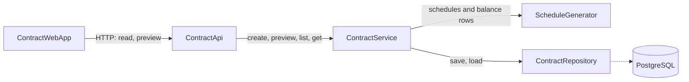

# Component Catalogue: expense balance columns

This change modifies existing components; it adds none. The catalogue below is the existing set (from the code knowledge base, `aidlc/spaces/default/codekb/Kiro-Workshop/component-inventory.md`), updated with what each component now does for this change. PostgreSQL stays a dependency, not a component.

## Machine-readable catalogue

```yaml
components:
  - name: ContractWebApp
    summary: React single-page app where Dana enters contracts, previews schedules and reads saved ones.
    behaviour: >
      Shows the expense schedule with the eight columns from the API (Period, Expense, (Accrual)/Prepaid,
      Cumulative Balance, ST and LT Accrued Liability, ST and LT Prepaid Asset) on the detail tab and in the
      preview popup, with no total row. Formats every amount in the app with thousands separators, 2 decimals
      and brackets for negatives; zero is always 0.00. Never calculates money; only formats what the API returns.
    responsibilities:
      - Render the expense balance table on the detail tab and in the 80 percent wide preview popup
      - Format all amounts in the bracket style
    depends_on:
      - component: ContractApi
        interaction: read saved contracts and request schedule previews over HTTP
        style: sync
    dependents: []
    external_dependencies:
      - name: shadcn/ui
        kind: other
        purpose: table and dialog components
    entities: []

  - name: ContractApi
    summary: .NET HTTP endpoints for creating, previewing, listing and reading contracts.
    behaviour: >
      Adds the balance rows to the expense schedule part of the contract detail and preview responses
      (additive within v1). Holds no business rules beyond request and response shape.
    responsibilities:
      - Map the balance rows into the expense schedule response
    depends_on:
      - component: ContractService
        interaction: create, preview, list and fetch contracts
        style: sync
    dependents:
      - component: ContractWebApp
        interaction: receives contract and preview requests from the UI
    external_dependencies: []
    entities: []

  - name: ContractService
    summary: Applies the contract rules, asks for schedules, saves and reads contracts.
    behaviour: >
      For a preview, passes the balance rows ScheduleGenerator returns. For a saved contract, reads the stored
      payment and expense rows and asks ScheduleGenerator to build the balance rows from them, so nothing new
      is stored and existing contracts get the columns without migration. Owns the Contract aggregate, unchanged.
    responsibilities:
      - Ask for balance rows on preview and on read
      - Own the Contract, PaymentStream, PaymentScheduleEntry and ExpenseScheduleEntry entities (unchanged)
    depends_on:
      - component: ScheduleGenerator
        interaction: generate schedules and build balance rows from payment and expense rows
        style: sync
      - component: ContractRepository
        interaction: store and load a contract with its schedules
        style: sync
    dependents:
      - component: ContractApi
        interaction: handles contract requests
    external_dependencies: []
    entities:
      - name: Contract
        identifier: contractId
        attributes: [name, startDate, endDate, expenseMethod, expenseStartDate, expenseEndDate, expenseDate, createdAt]
        references: []
      - name: PaymentStream
        identifier: streamId
        attributes: [contractId, position, amount, frequency, startDate, endDate]
        references: []
      - name: PaymentScheduleEntry
        identifier: paymentEntryId
        attributes: [contractId, streamId, dueDate, amount]
        references: []
      - name: ExpenseScheduleEntry
        identifier: expenseEntryId
        attributes: [contractId, periodStart, periodEnd, amount]
        references: []

  - name: ScheduleGenerator
    summary: Pure rules that turn payment streams and an expense method into schedules and balance rows.
    behaviour: >
      Unchanged payment and expense rules. New: from a payment schedule and an expense schedule, builds one
      balance row per calendar month that has a payment or an expense (expense 0 for payment-only months).
      Each row has (Accrual)/Prepaid = payments due in the month minus the month's expense, a running
      Cumulative Balance that ends at 0, and the split of the balance into the part that reverses within 12
      months after the row's period end (ST) and the rest (LT), placed in the Prepaid Asset columns when the
      balance is positive and the Accrued Liability columns when it is negative; the other pair is 0. ST and LT
      are never negative and add up to the size of the balance. Method None gives no rows. Deterministic, no I/O.
    responsibilities:
      - Payment and expense schedule generation (unchanged)
      - Balance row building (new, FR1 and FR2)
    depends_on: []
    dependents:
      - component: ContractService
        interaction: asks for schedules and balance rows
    external_dependencies: []
    entities: []

  - name: ContractRepository
    summary: Stores and loads contracts with their schedules in PostgreSQL.
    behaviour: >
      Unchanged. Balance rows are not stored.
    responsibilities:
      - Persist and load the Contract aggregate atomically
      - List contracts
    depends_on: []
    dependents:
      - component: ContractService
        interaction: stores and loads contracts
    external_dependencies:
      - name: PostgreSQL
        kind: database
        purpose: stores contracts, streams and both schedules
    entities: []
```

## Component Diagram



Text fallback: ContractWebApp calls ContractApi. ContractApi calls ContractService. ContractService calls ScheduleGenerator for schedules and balance rows, and ContractRepository to save and load. ContractRepository uses PostgreSQL.

## Component Summary

| Component | Purpose | Depends On | Dependents | Entities Owned |
|---|---|---|---|---|
| ContractWebApp | Screens; shows the balance table and formats amounts | ContractApi | none | none |
| ContractApi | HTTP shapes; adds balance rows to responses | ContractService | ContractWebApp | none |
| ContractService | Rules and orchestration; asks for balance rows on preview and read | ScheduleGenerator, ContractRepository | ContractApi | Contract, PaymentStream, PaymentScheduleEntry, ExpenseScheduleEntry |
| ScheduleGenerator | Pure schedule rules, now including balance rows | none | ContractService | none |
| ContractRepository | PostgreSQL storage, unchanged | none | ContractService | none |

## Entity Ownership

| Entity | Owning Component | Identifier | Attributes | References |
|---|---|---|---|---|
| Contract | ContractService | contractId | name, startDate, endDate, expenseMethod, expenseStartDate, expenseEndDate, expenseDate, createdAt | none |
| PaymentStream | ContractService | streamId | contractId, position, amount, frequency, startDate, endDate | none |
| PaymentScheduleEntry | ContractService | paymentEntryId | contractId, streamId, dueDate, amount | none |
| ExpenseScheduleEntry | ContractService | expenseEntryId | contractId, periodStart, periodEnd, amount | none |

No new entity. A balance row is a calculated value, not a stored entity (ADR-002).

## External Dependencies

| Component | Dependency | Kind | Purpose |
|---|---|---|---|
| ContractWebApp | shadcn/ui | other | table and dialog |
| ContractRepository | PostgreSQL | database | contracts, streams and schedules |

## Rationale

| Component | Why it is a separate building block |
|---|---|
| ScheduleGenerator | Distinct concern (money and date rules), no data store; the balance rules belong with the other schedule rules so they are tested alone (answer to Q1, option A) |
| ContractService | Owns the aggregate and the read and preview flows; it only wires the balance rows in |
| ContractApi | HTTP shape; changes only by adding fields |
| ContractWebApp | Display and formatting only |
| ContractRepository | Storage; unchanged because nothing new is stored |

**Alternatives Rejected:**
- Balance rules in ContractService (Q1, option B): fewer changes to the library, but money rules would live in two places and need the API test setup. See ADR-001.
- A new balance library (Q1, option C): an extra project for one function that depends on the same schedule types. See ADR-001.
