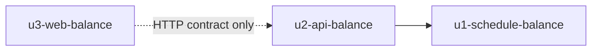

# Unit Dependencies: expense balance columns

## Dependency DAG

- U2 u2-api-balance depends on U1 u1-schedule-balance: the API calls U1's balance-row builder, and U2's tests need it to build and pass.
- U3 u3-web-balance depends on no unit's code: it reads the balance rows through the HTTP API defined in Contract Design and tests against a fake API that follows that contract.
- U1 depends on nothing.



Text fallback: U2 depends on U1. U3 has no code dependency; it uses U2 only through the HTTP contract.

```yaml
units:
  - name: u1-schedule-balance
    kind: library
    depends_on: []
  - name: u2-api-balance
    kind: service
    depends_on: [u1-schedule-balance]
  - name: u3-web-balance
    kind: ui
    depends_on: []
```

## Integration points

| From | To | Mechanism | What crosses |
|---|---|---|---|
| U2 | U1 | in-process .NET call (contract C2) | payment and expense rows in, balance rows out |
| U3 | U2 | HTTP JSON (contract C1, v1) | balance rows in the expense schedule of the contract detail and the preview responses |

## Parallel development opportunities

- U1 and U3 have no dependency between them and can be built at the same time.
- U2 can start once U1's builder exists.
- More than one valid topological order exists; Delivery Planning chooses.

## Walking skeleton

Not applicable: the team does not build a walking skeleton (team.md), and the app already runs end to end.
